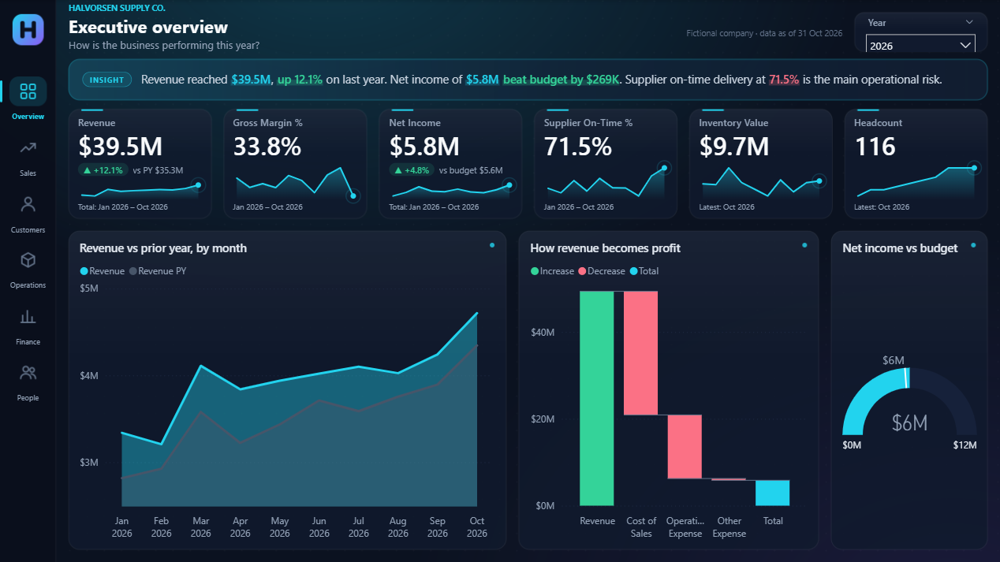
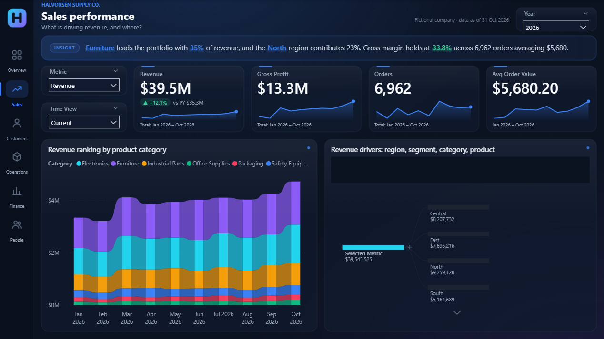
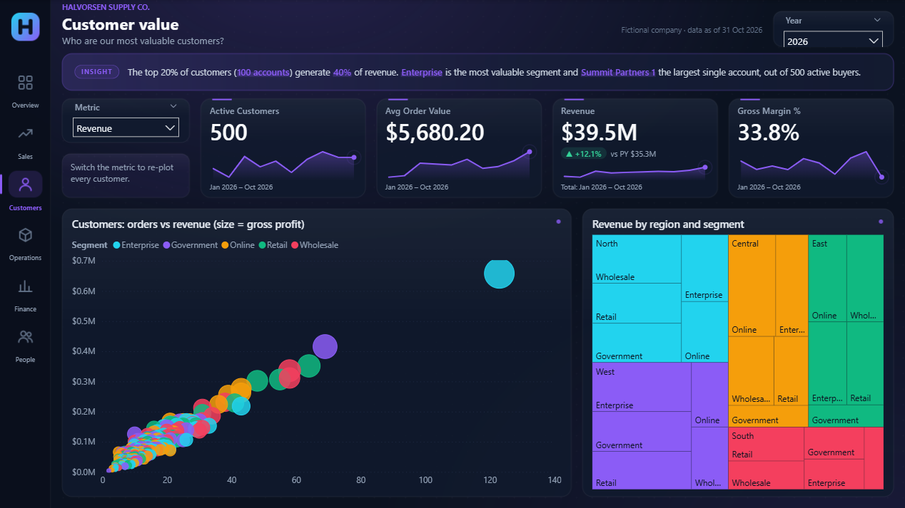
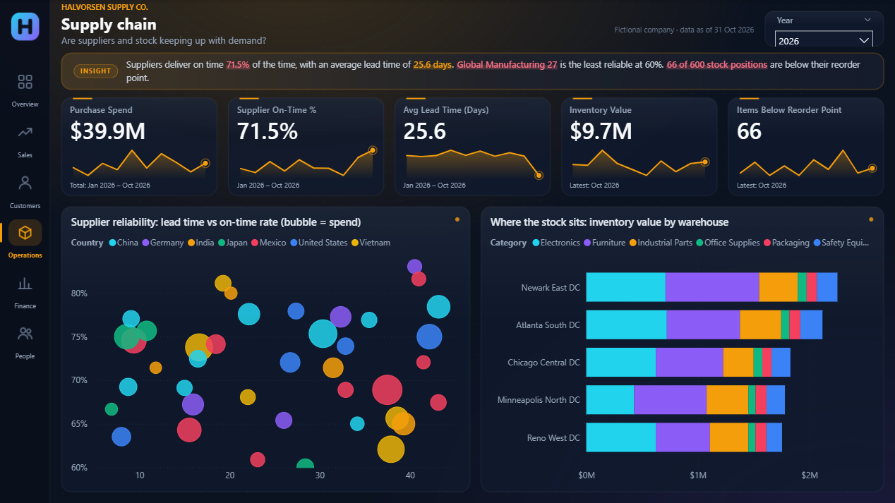
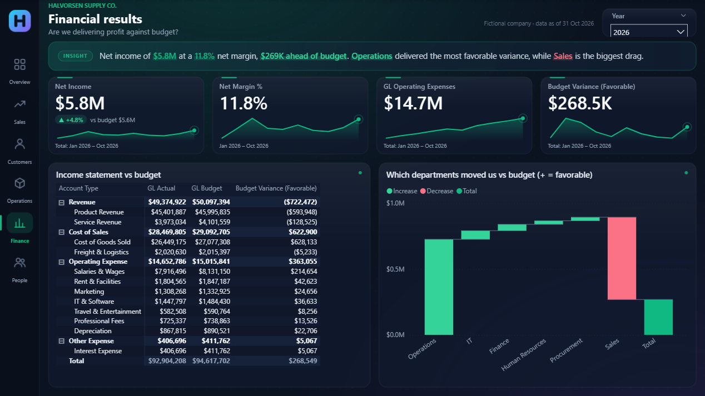
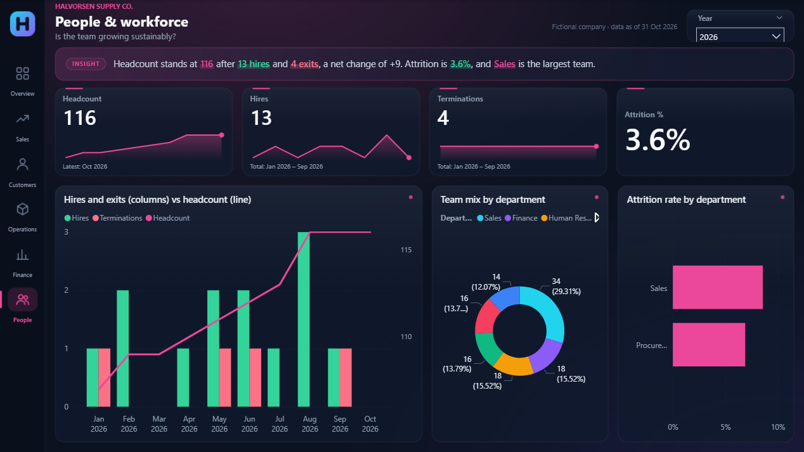
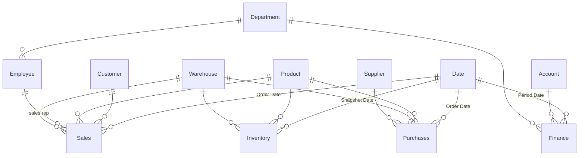

# Halvorsen Supply Co. · ERP Analytics in Power BI

An end-to-end Power BI portfolio project: a five-module ERP semantic model, a six-page storytelling dashboard on a designed dark canvas, and two custom visuals animated with GSAP.

> **Halvorsen Supply Co. is a fictional company.** All data is generated sample data (Jan 2024 to Oct 2026). Any resemblance to a real business is coincidental.



| Sales | Customers |
|---|---|
|  |  |

| Operations | Finance |
|---|---|
|  |  |

| People |  |
|---|---|
|  |  |

## The story

Every page is built around one business question. An auto-written insight banner answers it for the selected year, before the reader looks at a single chart.

| Page | Question | How it answers |
|---|---|---|
| **Overview** | How is the business performing this year? | KPI strip, revenue vs prior year, a waterfall from revenue to net income, a gauge for net income vs budget |
| **Sales** | What is driving revenue, and where? | Ribbon chart ranking categories month by month, a decomposition tree (region > segment > category > product), Metric and Time View switchers |
| **Customers** | Who are our most valuable customers? | Scatter of all 500 customers (orders vs the selected metric, bubble = gross profit), region and segment treemap |
| **Operations** | Are suppliers and stock keeping up with demand? | Supplier reliability scatter (lead time vs on-time rate, bubble = spend), inventory by warehouse and category |
| **Finance** | Are we delivering profit against budget? | Income statement vs budget, a waterfall of budget variance by department |
| **People** | Is the team growing sustainably? | Hires and exits vs headcount, team mix, attrition by department |

Example insight (2026 Overview), generated by DAX:

> Revenue reached **$39.5M**, **up 12.1%** on last year. Net income of **$5.8M** **beat budget by $269K**. Supplier on-time delivery at **71.5%** is the main operational risk.

## What's inside

### Semantic model (`ERP-Portfolio.SemanticModel`)

- **Star schema, 5 subject areas**: Sales (60k order lines), Purchasing (8k PO lines), Inventory (month-end snapshots), Finance (GL actuals and budget) and HR. All of them share one set of dimension tables.
- **18 single-direction relationships**, plus two inactive date roles (ship date, received date) activated with `USERELATIONSHIP`.
- **Marked date table** with an `Is Past` flag, so prior-year comparisons stay like-for-like in a partial year.
- **62 measures** in a `_Measures` table, organized into display folders. Each has a description and a format string.
  - Sales and time intelligence: YoY %, YTD, prior-year YTD
  - Purchasing and supplier performance
  - **Semi-additive** inventory measures: last snapshot, turnover, days of inventory
  - Finance: P&L, sign-adjusted favorable variance
  - HR: point-in-time headcount, hires, terminations, attrition
- **Time View calculation group** (Current, Prior Year, YoY, YoY %, YTD) that works on any measure, with dynamic format strings.
- **Metric switcher**: a disconnected table plus `[Selected Metric]` with a dynamic format string. Chart titles are driven by measures too.
- **Period measures** (`* (Period)`): whole-period values for ratios and distinct counts (margin %, on-time %, AOV, active customers), so KPI headlines are never wrongly summed or averaged from monthly points.
- **Narrative measures** (`Story *`): DAX that writes each page's insight, picking out leaders, laggards and budget gaps from the data.
- **Deterministic sample data**: every table is generated in Power Query from a shared hash-based pseudo-random function, so numbers are identical on every refresh.



### Report (`ERP-Portfolio.Report`, PBIR format)

- **Designed canvas**: each page background (navy base, accent glow, icon sidebar with the active page highlighted, rounded panels) is rendered from SVG. Transparent visuals sit on top.
- **One accent color per page**, carried through the glow, sidebar, KPI sparklines, insight banner and charts.
- **Custom dark theme** covering charts, tables, matrices, slicers and tooltips.
- **Synced slicers** (Year across all pages, Metric across Sales and Customers). Visual interactions are tuned so the Time View switcher changes the charts but not the KPI cards.

### Custom visuals (`visuals/`)

| Visual | What it does |
|---|---|
| **ERP KPI Card (GSAP)** | Count-up headline, comparison badge (favorable or unfavorable, with a "higher is better" switch), self-drawing sparkline with hover readout. Headline can be the latest period, the sum, the average, or a separate whole-period measure (for ratios). Respects reduced-motion and high-contrast settings. |
| **Insight Text (GSAP)** | Renders a DAX text measure with `[*accent]`, `[+favorable]` and `[-unfavorable]` markup, revealing it word by word with a highlight sweep. |

Both are TypeScript `pbiviz` projects with GSAP bundled in (no web access needed), plus a local browser harness for testing outside Power BI.

### Report generator (`tools/`)

`tools/build-report-pages.mjs` generates the whole report definition from one layout spec:
- page backgrounds
- pages and visuals
- the theme
- the embedded custom visuals

It checks that every field it references exists in the model. Its output is validated against Microsoft's published PBIR JSON schemas.

## Open it

1. Install [Power BI Desktop](https://powerbi.microsoft.com/desktop/) (recent version, PBIR support).
2. Open `ERP-Portfolio.pbip`. The custom visuals are embedded, so there's nothing to import.

## Rebuild

```bash
# Custom visuals (from each visual folder)
cd visuals/erpKpiCard && npm install && npm run package
cd visuals/insightText && npm install && npm run package

# Report pages, backgrounds and theme (close Power BI Desktop first)
cd tools && npm install && npm run build
```

`npm run build` replaces all report pages, so make layout changes in the generator rather than in Desktop. `node build-report-pages.mjs --preview` renders only the backgrounds to `tools/out/`.

## Repository layout

```
ERP-Portfolio.pbip               Power BI project
ERP-Portfolio.SemanticModel/     Model as TMDL (tables, measures, relationships, calculation group)
ERP-Portfolio.Report/            Report as PBIR (pages, visuals, theme, backgrounds, embedded visuals)
visuals/erpKpiCard/              ERP KPI Card custom visual (TypeScript + GSAP)
visuals/insightText/             Insight Text custom visual (TypeScript + GSAP)
tools/                           Report generator and theme
```

## Tooling

Built with Power BI Desktop, the [Power BI Modeling MCP server](https://www.npmjs.com/package/@microsoft/powerbi-modeling-mcp) and Claude Code. The modeling server was used to create the tables, relationships, measures and calculation group in the open Desktop model. `powerbi-visuals-tools` (pbiviz) and GSAP were used for the custom visuals, and Node with sharp for the report generator.

## License

MIT for the code in `visuals/` and `tools/`. The sample data is fictional and free to reuse.
